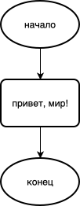
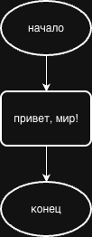
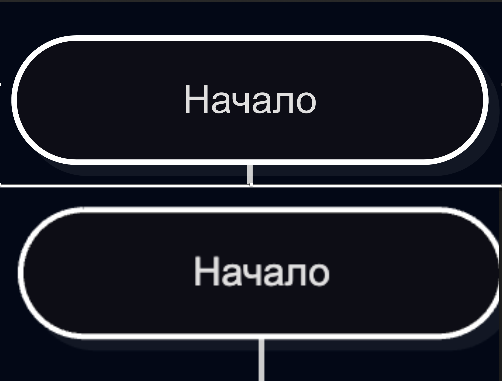
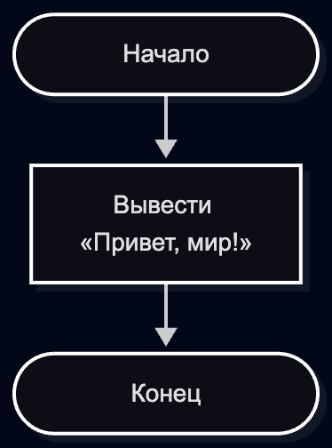
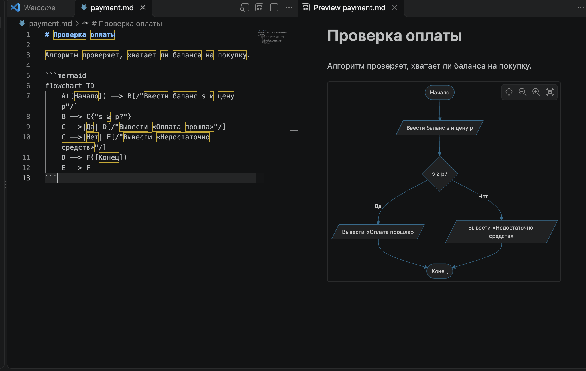

# Лабораторная работа №3. Диаграмма как код

- **Курс:** Цифровые технологии и искусственный интеллект
- **Студент:** Никитин С.И.
- **Группа:** ИВТ-ИСУ-104Б
- **Преподаватель:** Зиязетдинов Д. С.
- **Дата:** 27.11.2026
## 3.1 Алгоритм

### Что такое алгоритм
*Источник: [Википедия — Алгоритм](https://ru.wikipedia.org/wiki/Алгоритм)*

Алгоритм — это чёткая последовательность шагов, которая приводит к решению задачи
или к нужной цели. Каждый шаг описан точно и понятно, а выполнять их нужно
в определённом порядке. Сначала заказчик (или мы сами) ставит цель, потом
составляется алгоритм, и только после этого пишется программа. Так проще
избежать ситуации, когда всё приходится переделывать.

### Происхождение слова
Слово «алгоритм» пришло от имени среднеазиатского учёного-математика
аль-Хорезми, жившего в IX веке. Его прозвище означает «человек из города
Хорезм». Он написал книгу о десятичной системе счисления и правилах
арифметических вычислений. Когда её перевели на латынь, имя автора записали
как Algorithmi, и со временем так стали называть сами правила вычислений.
### Блок-схема и стандарты
*Источник: [Википедия — Блок-схема](https://ru.wikipedia.org/wiki/Блок-схема)*

Блок-схема (сейчас чаще говорят «схема алгоритма») — это графическое описание
алгоритма. Оно составляется из блоков, которые соединены стрелками. Форма блока
показывает, какое действие в нём выполняется. Основные обозначения:

- **терминатор** (овал со скруглёнными краями) — начало и конец алгоритма;
- **процесс** (прямоугольник) — выполнение действия или вычисление;
- **решение** (ромб) — проверка условия, из ромба выходят ветки «да» и «нет»;
- **данные** (параллелограмм) — ввод и вывод данных;
- **предопределённый процесс** — вызов подпрограммы или функции;
- **соединитель** (маленький круг) — переход на другое место схемы.

**Стандарт.** Правила оформления схем алгоритмов в России задаёт
ГОСТ 19.701-90 («Схемы алгоритмов, программ, данных и систем. Условные
обозначения и правила выполнения»). В конце текста стандарта приведены
примеры оформленных схем.

**Английское название.** В английской Википедии статья называется
**Flowchart**. Flow означает «поток», chart — «схема, график», то есть схема,
которая показывает поток выполнения действий.
**Вывод.** «Блок-схема» и «схема алгоритма» означают одно и то же: графическое
описание алгоритма из блоков и стрелок. Слово «блок-схема» привычнее
и понятнее в обычной речи, а «схема алгоритма» — это официальное название
из ГОСТ. Правила рисования блоков (прямоугольник — действие, ромб — условие)
при этом не менялись. Workflow Diagram (диаграмма потока работ) похожа
на схему алгоритма по значкам, но решает другую задачу: она показывает,
как работа и документы проходят между людьми и отделами (часто с «дорожками»
по ролям), а не как программа принимает решения.
### Draw.io: схема из трёх блоков и сохранение в разных форматах

В сервисе Draw.io (diagrams.net) я создал пустую диаграмму и нарисовал простой
алгоритм из трёх блоков: терминатор «Начало», процесс и терминатор «Конец».
Блоки взяты из палитры Flowchart. Затем я сохранил схему в четырёх форматах
и сравнил их.

| Формат | Что внутри | Как отображается | При увеличении |
|--------|-----------|------------------|----------------|
| XML | Текстовый файл с описанием диаграммы: теги, координаты, стили, текст блоков. Если включено сжатие, содержимое выглядит как длинная строка символов | Как картинка не открывается, виден только текст | — |
| PNG | Растровое изображение: набор цветных точек (пикселей) | Открывается как обычная картинка | Появляются «квадратики» и размытие |
| SVG | Текстовый файл с описанием фигур и линий (теги `<svg>`, `<rect>`, `<text>`) | Открывается в браузере как картинка | Остаётся чётким при любом увеличении |
| HTML | Веб-страница, внутри которой лежат данные диаграммы и подключён просмотрщик | Открывается в браузере | Остаётся чётким, как векторная схема |

**Вывод.** PNG хранит картинку в виде точек, поэтому при сильном увеличении
качество ухудшается. SVG хранит не точки, а описание линий и фигур,
поэтому схема остаётся чёткой при любом масштабе (векторная графика).
Для вставки в документы, где важно качество, лучше подходит SVG.
XML удобен для хранения и редактирования самой диаграммы, но как картинку его
использовать нельзя. HTML удобен для публикации схемы на веб-странице.
### Схема из трёх блоков



### Схема из трёх блоков



#### Сравнение PNG и SVG при увеличении

Чтобы сравнить качество, я открыл экспортированные файлы PNG и SVG в браузере
с одинаковой шириной изображения и увеличил фрагмент с надписью в четыре раза.



*Рисунок 2 – Фрагмент экспорта Draw.io при увеличении в 4 раза (снизу PNG, сверху SVG)*

У PNG края букв стали размытыми, на границе штрихов видны ступеньки из точек.
У SVG контуры остались чёткими. Причина в разном устройстве форматов: PNG хранит
готовую сетку пикселей, а SVG хранит описание линий и фигур и заново строит
картинку при любом масштабе.

### Блок Terminator

Слово *terminator* образовано от латинского *terminare* («ограничивать,
завершать»), которое происходит от *terminus* («граница, предел»). Буквально
это «тот, кто завершает».

В схеме алгоритма блок Terminator обозначает **границы алгоритма**: начало
и конец (овал со скруглёнными краями), поэтому название ему подходит.

Фильм «Терминатор» (1984, в главной роли Арнольд Шварценеггер) назван так
же: персонаж — машина, которая «завершает» (устраняет) свою цель. Общее
у фильма и блока схемы — идея завершения, окончания, но по смыслу это
разные вещи, просто одно и то же английское слово.
### Mermaid: схема алгоритма кодом

Сервис: [Mermaid Live Editor](https://mermaid.live). Я нарисовал ту же схему из трёх блоков,
но не мышкой, а текстовым описанием:

```text
flowchart TD
    A([Начало]) --> B["Вывести «Привет, мир!»"]
    B --> C([Конец])
```

Первая строка задаёт тип диаграммы (`flowchart`) и направление (`TD` — сверху вниз).
Во второй и третьей строках описаны блоки и стрелки между ними. Форма блока
задаётся скобками: `([...])` — терминатор (начало и конец), `["..."]` —
прямоугольник (процесс), `-->` — стрелка. Диаграмма справа обновляется сразу
после изменения кода.

**Сохранение.** В разделе Actions схему можно сохранить в форматах PNG и SVG.
При увеличении PNG, как и у схемы из Draw.io, теряет чёткость, а SVG остаётся
чётким.

**Копирование в буфер обмена.** Я скопировал схему кнопкой *Copy image to clipboard*
и вставил в текстовый и графический редакторы. Изображение вставилось как
обычная картинка, при увеличении она стала нечёткой. Значит, в буфер
копируется **растровое изображение (PNG)**, а не векторное.





**Вывод.** Главное отличие от Draw.io: схему не рисуют, а описывают кодом.
Такой код короткий, его легко хранить в текстовом файле, править и сравнивать
версии. Изображение строится автоматически.

### Диаграмма в Markdown и VS Code

Схему из предыдущего пункта можно хранить прямо в Markdown-файле. Для этого
код помещают между строками из трёх обратных кавычек, а после открывающих
кавычек пишут `mermaid`. Тогда программа понимает, что внутри блока код диаграммы,
а не обычный текст. Я создал файл [`payment.md`](payment.md) с таким блоком.

Для проверки я открыл файл в VS Code, установил расширение Markdown Preview Mermaid
Support и включил предпросмотр рядом с кодом.



*Рисунок 4 – Исходный Markdown и его предпросмотр в VS Code*

Слева виден исходный текст, справа построенная диаграмма с ромбом и двумя
стрелками «Да» и «Нет». Заголовок и схема получаются из одного текстового
файла. Так же файл с блоком `mermaid` отображается на GitHub: схема строится
прямо на странице репозитория. Преимущество такого подхода в том, что схему
можно править как обычный текст и хранить вместе с остальными файлами проекта.

